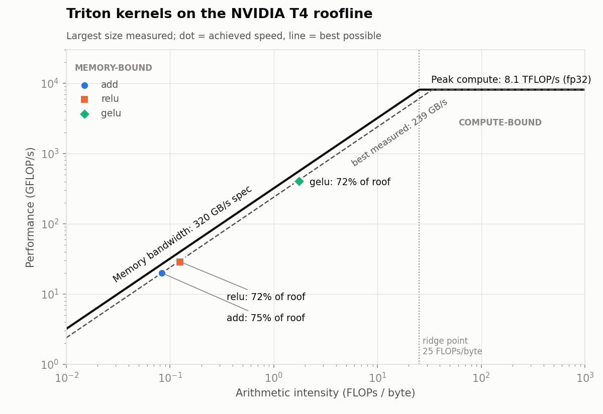

# triton-roofline

Triton GPU kernels, benchmarked and compared against a roofline model I built myself.



> **Status:** week 1 of 3 (started Oct 27, 2026). Elementwise kernels are done; fusion and matmul come next.

## Results so far: elementwise kernels on a T4

Measured at 64M fp32 elements, on a Google Colab T4. Every kernel's output is checked against PyTorch before timing.

| Kernel | Bytes / element | Triton | PyTorch | % of 320 GB/s spec | % of roofline |
|---|---|---|---|---|---|
| add | 12 | 239 GB/s | 239 GB/s | 74.8% | 75% |
| relu | 8 | 231 GB/s | 230 GB/s | 72.1% | 72% |
| gelu | 8 | 231 GB/s | 231 GB/s | 72.3% | 72% |

Raw data: [`results/elementwise.csv`](results/elementwise.csv)

## What I found

1. **All three kernels are memory-bound.** Their arithmetic intensity (0.08–1.75 FLOPs/byte) is far below the T4's ridge point of 25 FLOPs/byte, so their speed is set by how fast data moves, not by math.
2. **GELU is as fast as ReLU,** 2.320 ms vs 2.327 ms, even though GELU does far more math per element (it calls `erf`). Both move 8 bytes per element, and the extra math hides behind the memory traffic.
3. **About 75% of the spec bandwidth is the practical ceiling.** PyTorch's own kernels level off at the same 230–239 GB/s, so my kernels reach the limit the T4 delivers in practice, not the spec-sheet number.
4. **Small inputs are dominated by launch overhead.** From 1K to 16K elements every kernel takes 4–7 µs regardless of size: at 1K elements that's under 1% of peak bandwidth. Bandwidth only gets close to 70% of spec around 1M elements (8–12 MB).

## How the roofline model works

For each kernel I count the FLOPs and bytes moved by hand. The model predicts a lower bound on time:

```
predicted time = max(FLOPs / peak FLOP/s,  bytes moved / peak bandwidth)
% of roofline  = predicted time / measured time
```

Hardware specs live in [`hardware.py`](src/troof/hardware.py) as data, so the same model works for any accelerator by adding one entry.

## Next

- **Fused softmax and RMSNorm (by Nov 9):** show how fusing operations cuts memory traffic, with byte counts and before/after numbers.
- **Tiled matmul with autotuning (by Nov 9):** TFLOP/s vs matrix size, crossing from memory-bound to compute-bound.
- **Per-kernel cost model (by Nov 16):** every kernel declares its FLOPs and bytes; one table of predicted vs achieved for every kernel and shape.
- **Measure the achievable bandwidth ceiling** directly with a copy kernel.

## Layout

```
src/troof/
  hardware.py      GPU specs (bandwidth, peak FLOP/s)
  roofline.py      arithmetic intensity -> predicted lower-bound time, plots
  kernels/         Triton kernels
  bench/           benchmark harness
scripts/
  run_bench.py     run benchmarks on a GPU -> results/*.csv
  plot_roofline.py results/*.csv -> figures/*.png (no GPU needed)
notebooks/         colab_runner.ipynb runs everything on a Colab T4
```

## Running

Benchmarks need an NVIDIA GPU. Open [`notebooks/colab_runner.ipynb`](notebooks/colab_runner.ipynb) in Google Colab with a T4 runtime and run all cells. The chart can be regenerated anywhere with `python scripts/plot_roofline.py`.
