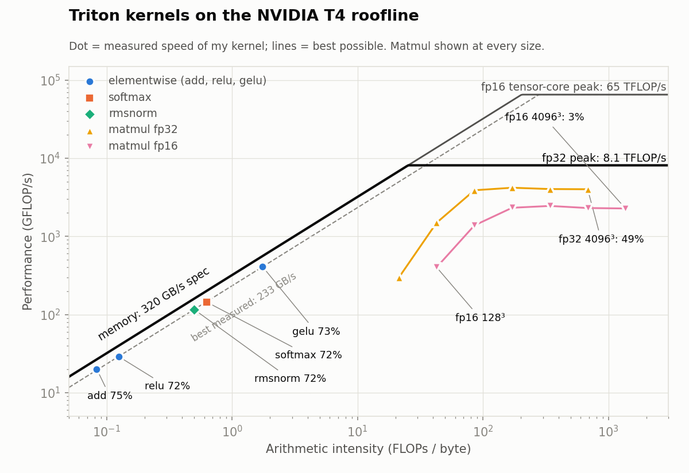
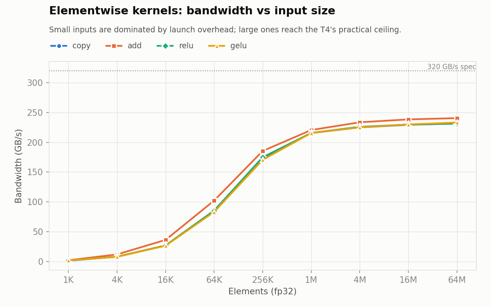
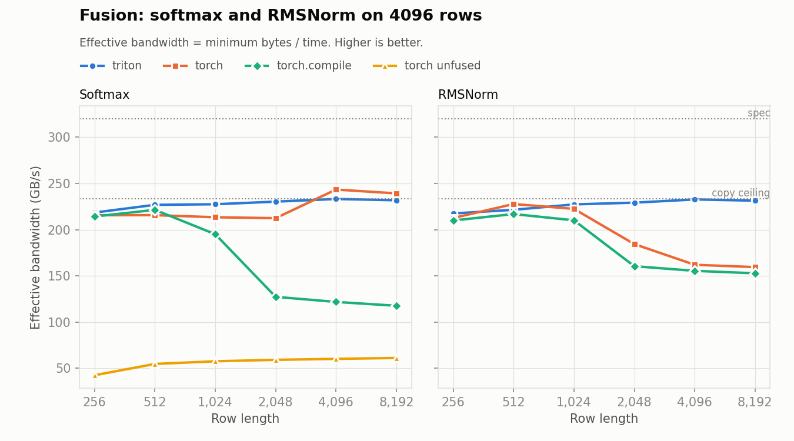
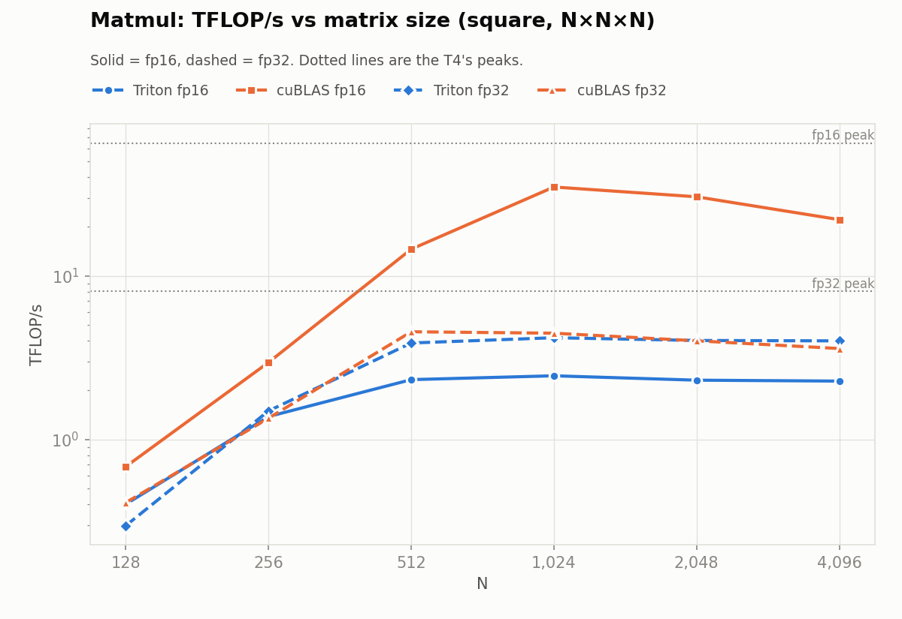

# triton-roofline

Triton GPU kernels, benchmarked against PyTorch and compared with a per-kernel roofline cost model.



All numbers are from a Google Colab **NVIDIA T4**. Before it is timed, every kernel's output is checked against PyTorch.

## Results

| Kernel | Shape | Bound by | % of roofline | vs PyTorch |
|---|---|---|---|---|
| add | 64M elements | memory | 75% | 1.00× |
| relu | 64M elements | memory | 72% | 1.00× |
| gelu | 64M elements | memory | 73% | 1.00× |
| softmax (fused) | 4096 × 8192 | memory | 72% | 0.97× |
| RMSNorm (fused) | 4096 × 8192 | memory | 72% | **1.45×** |
| matmul fp32 | 4096³ | compute | 49% | **1.11×** vs cuBLAS |
| matmul fp16 | 4096³ | compute | 3% | 0.10× vs cuBLAS (see below) |

% of roofline = the model's lower-bound time ÷ measured time. Full tables for every kernel and shape: [`results/summary.md`](results/summary.md). Raw data: [`results/`](results/).

## What I found

### 1. Memory-bound kernels top out at ~75% of spec bandwidth



- add, relu, gelu, softmax and RMSNorm all have an arithmetic intensity of 0.08–1.75 FLOPs/byte, far below the T4's ridge point of 25. Their speed is set by memory traffic, not math.
- **GELU runs as fast as ReLU** (2,302 µs vs 2,318 µs at 64M elements), even though it calls `erf`. Both move 8 bytes per element, and the extra math hides behind the memory traffic.
- The best bandwidth any kernel reached is **241 GB/s, 75% of the 320 GB/s spec**, and PyTorch's own kernels level off at the same place. That's the practical ceiling on this GPU, not a gap in my kernels.
- **Small inputs are all launch overhead.** From 1K to 4K elements every kernel takes 4–7 µs regardless of size (under 4% of peak bandwidth). Bandwidth reaches 67–69% of spec at 1M elements.

### 2. Fusion: the cost model predicted the slowdown



Softmax written as 5 separate PyTorch ops (max, subtract, exp, sum, divide) reads and writes the whole matrix several times. My cost model counts **1,074 MB** of traffic for that version, against **268 MB** for a single fused kernel: 4.0× more. Measured on 4096 × 8192:

| Version | Bytes moved (model) | Time |
|---|---|---|
| My fused Triton kernel | 268 MB | 1,158 µs |
| `torch.softmax` (fused) | 268 MB | 1,122 µs |
| Unfused, 5 PyTorch ops | 1,074 MB | 4,385 µs (**3.8× slower**) |

The 4.0× traffic prediction matches the measured 3.8× slowdown, which supports the model.

- **RMSNorm:** my fused kernel holds 68–73% of the roofline (217–233 GB/s) at every row length. From row length 2048 up, PyTorch eager (`F.rms_norm`) and `torch.compile` drop to 153–184 GB/s, so mine is **1.45× faster** than eager at 8192.
- **`torch.compile` softmax** runs at almost exactly half the bandwidth of eager PyTorch at row lengths 4096 and 8192 (118 vs 239 GB/s at 8192). That would fit a kernel that reads the input twice, but I haven't confirmed it from the generated code.

### 3. Matmul: fp32 matches cuBLAS; fp16 exposed a compiler limitation



- **fp32:** the autotuned kernel (128×128×32 tiles, 8 warps) reaches **4.0 TFLOP/s at 4096³, 49% of the fp32 roofline**, slightly ahead of cuBLAS (3.6 TFLOP/s). At small sizes the matmul is memory-bound, as the roofline predicts (128³ sits left of the fp32 ridge).
- **fp16:** cuBLAS reaches 35 TFLOP/s at 1024³ using the T4's tensor cores. My Triton kernel reached at most 2.5 TFLOP/s, **3% of the roofline** at 4096³, and slower than my own fp32 version.

The roofline flagged that 3% as wrong, so I wrote [`scripts/diagnose_matmul.py`](scripts/diagnose_matmul.py), which compiles every tile config on its own, times it, and inspects the generated PTX ([output](results/matmul_diagnostic.txt)):

- **Zero tensor-core instructions** (`mma.sync`, `ldmatrix`) in every fp16 config. On this T4 (sm_75), with the Triton version on Colab, `tl.dot` on fp16 is compiled to plain FMA instructions, just like fp32.
- **Large fp16 tiles spill registers badly:** 128×128×32 is capped at 64 registers with 1,000–2,900 spills and runs at 0.05–0.08 TFLOP/s. Only 32×32×32 avoids spilling (2.35 TFLOP/s), which is why the autotuner picked it at every size.
- **`num_stages` changes nothing for fp16:** there are no `cp.async` (asynchronous copy) instructions in any config, so the software pipelining that `num_stages` controls has nothing to overlap.

Measured against the roof it can actually use (fp32 FMA, 8.1 TFLOP/s), the fp16 kernel reaches 28%.

## How the cost model works

Each kernel declares its FLOPs and minimum bytes moved as functions of its shape ([`costmodel.py`](src/troof/costmodel.py)):

| Kernel | FLOPs | Bytes (fp32 = 4 per element) |
|---|---|---|
| add | n | 3n × 4 |
| relu / gelu | n / 14n | 2n × 4 |
| softmax | 5mn | 2mn × 4 |
| RMSNorm | 4mn | (2mn + n) × 4 |
| matmul | 2mnk | (mk + kn + mn) × bytes per element |

The roofline then gives a lower bound on time for any hardware:

```
predicted time = max(FLOPs / peak FLOP/s,  bytes / peak bandwidth)
% of roofline  = predicted time / measured time
```

GPU specs live in [`hardware.py`](src/troof/hardware.py) as data, so pointing the model at a different accelerator means adding one entry. GELU's FLOP count is an estimate (erf is a short polynomial); it moves GELU's dot on the chart but doesn't affect its predicted time, which is set by bytes.

## What I'd try next

- **fp16 matmul without tensor cores:** load fp16 tiles but upcast to fp32 before `tl.dot`, so it uses the non-spilling fp32 FMA path while still moving half the bytes.
- **Run on an Ampere or newer GPU** (L4, A100), where Triton emits tensor-core and `cp.async` instructions, and check how close fp16 matmul gets to cuBLAS.
- **Inspect `torch.compile`'s generated softmax and RMSNorm kernels** to confirm why they fall to half bandwidth on long rows.
- **Model cache effects:** the bytes model assumes every input is read from DRAM exactly once; matmul tiles reuse data through L2 and shared memory, so measuring actual DRAM traffic (Nsight Compute) would test that assumption.

## Layout

```
src/troof/
  hardware.py        GPU specs (bandwidth, peak FLOP/s per dtype)
  roofline.py        roofline: attainable FLOP/s and lower-bound time
  costmodel.py       per-kernel FLOPs and bytes -> predicted time, memory- vs compute-bound
  kernels/           Triton kernels: elementwise, softmax, rmsnorm, matmul
  bench/harness.py   timing, CSV output
  plots.py           charts
scripts/
  run_bench.py       check every kernel against PyTorch, time it -> results/*.csv (GPU)
  report.py          results/*.csv -> figures/*.png and results/summary.md (no GPU needed)
  diagnose_matmul.py per-config timing and PTX inspection for the matmul kernel (GPU)
notebooks/           colab_runner.ipynb runs everything on a Colab T4
```

## Running

Benchmarks need an NVIDIA GPU. Open [`notebooks/colab_runner.ipynb`](notebooks/colab_runner.ipynb) in Google Colab with a T4 runtime and run all cells (~15 minutes). Charts and tables can be regenerated anywhere from the CSVs with `python scripts/report.py`.
